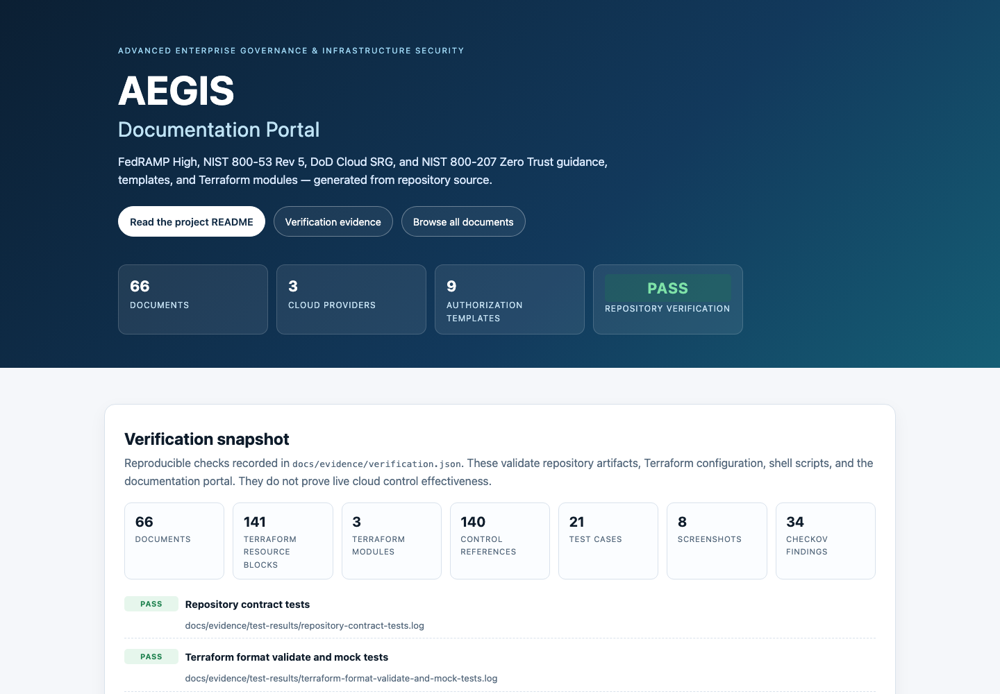
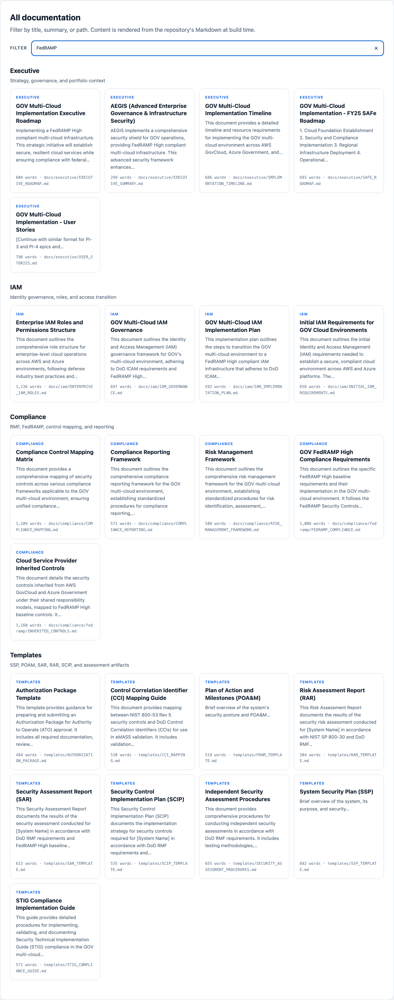
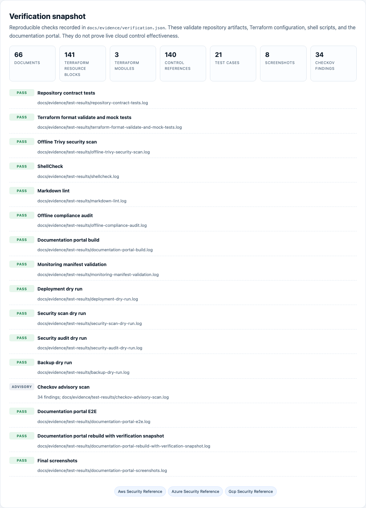
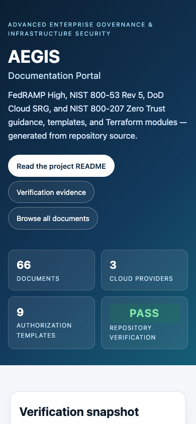

# AEGIS (Advanced Enterprise Governance & Infrastructure Security)

> A unified multi-cloud federal security framework aligned to FedRAMP High, NIST 800-53 Rev 5, DoD Cloud SRG, and NIST 800-207 Zero Trust principles across AWS GovCloud, Azure Government, and GCP.

[](https://www.fedramp.gov/)
[](https://csrc.nist.gov/publications/detail/sp/800-53/rev-5/final)
[](https://dl.dod.cyber.mil/wp-content/uploads/cloud/zip/U_Cloud_Computing_SRG_V1R4.zip)
[](https://csrc.nist.gov/publications/detail/sp/800-207/final)
[](LICENSE)

**Verification status: PARTIAL PASS.** All offline repository checks pass. The
Terraform root validates and plans against mock providers, but no live cloud
plan/apply was executed because this audit had no cloud credentials or
provisioned remote-state backend. See the
[verification report](docs/evidence/verification-report.md) for the complete
accounting.

---

## Overview

AEGIS is a **governance, compliance, and infrastructure-as-code repository**, not
a hosted web application. It combines:

- Federal authorization artifacts: SSP, POA&M, SAR, RAR, SCIP, authorization
  package, CCI mapping, and assessment procedures.
- Zero Trust and IAM guidance for PIV/CAC authentication, RBAC/ABAC, and access
  transition.
- Multi-cloud Terraform modules for AWS GovCloud, Azure Government, and GCP.
- Operations material: incident response, DR/BC, CSPM, security metrics,
  monitoring configuration, and supply-chain guidance.
- Executable automation for validation, security scanning, compliance evidence,
  monitoring manifests, backups, and documentation publishing.

The repository is intentionally self-contained: the offline verification suite
runs without cloud accounts. Live cloud scans and deployments require the
credentials described below and were **not** performed during this audit.

---

## Technology stack

| Layer | Technology |
| --- | --- |
| Infrastructure as code | Terraform 1.12+, AWS provider 6.x, AzureRM 4.x, Google provider 6.x |
| Policy and security checks | Trivy, tfsec, Checkov (advisory) |
| Automation | Bash 3.2+ / 5.x |
| Tests | Python 3.10+ `unittest`, Terraform native `terraform test` with mock providers |
| Documentation | Markdown, Python Markdown, generated static portal |
| Browser verification | Playwright + Chromium |
| CI | GitHub Actions (workflow added; not executed on GitHub during this audit) |

There is no Go build and no Node runtime dependency for the repository itself.
Node is only needed if you install `markdownlint-cli` with npm.

---

## Repository structure

```text
AEGIS/
├── Makefile                          # Validation, tests, docs, security, deployment
├── automation/
│   ├── compliance/audit/             # Offline compliance evidence
│   ├── deployment/infrastructure/    # Terraform plan/apply wrapper
│   ├── maintenance/                  # Verified backup and safe cleanup
│   └── security/scanning/            # Live scans/audit and dry-run paths
├── data/                             # Jira import data
├── diagrams/                         # SVG architecture diagrams
├── docs/
│   ├── architecture/                 # Architecture, network, Zero Trust
│   ├── compliance/                   # Control mapping, FedRAMP, RMF
│   ├── executive/                    # Executive and roadmap artifacts
│   ├── iam/                          # IAM governance and implementation
│   ├── operations/                   # Deployment, CSPM, DevSecOps, eMASS
│   ├── security/                     # Policies, metrics, threat modeling
│   ├── evidence/                     # Verification report, logs, screenshots
│   └── generate-docs.sh              # Static documentation portal generator
├── itsm_templates/                   # ServiceNow, Jira, Remedy material
├── monitoring/                       # Dashboards, alerts, logging configuration
├── raci/                             # Federal enterprise RACI matrices
├── security-reference/               # AWS, Azure, and GCP reference guides
├── templates/                        # SSP, POA&M, SAR, RAR, SCIP, STIG
├── terraform/
│   ├── environments/production/southeast/
│   │   ├── main.tf                   # Module composition
│   │   ├── providers.tf              # Explicit AWS/Azure/GCP providers
│   │   ├── variables.tf              # Declared inputs
│   │   ├── terraform.tfvars.example  # Non-secret example inputs
│   │   └── tests/                    # Terraform mock-provider tests
│   ├── modules/
│   │   ├── compute/{aws,azure,gcp}
│   │   ├── database/{aws,azure,gcp}
│   │   └── networking/{aws,azure,gcp}
│   └── providers/{aws,azure,gcp}     # Standalone provider reference configs
└── tests/
    ├── test_repository.py            # Offline contract and hygiene tests
    ├── e2e/test_docs_portal.py       # Playwright E2E and screenshots
    ├── write_verification.py         # Machine-readable evidence snapshot
    └── run-tests.sh                  # Full reproducible verification runner
```

Only the `production/southeast` environment currently exists. The development,
staging, and other region directories referenced in older documentation are not
present.

---

## Prerequisites

### Offline validation (no cloud account required)

- Terraform 1.12+ (1.17.1 used for the recorded verification)
- Python 3.10+ with `pip`
- `jq`
- `shellcheck` (for the lint gate)
- `trivy` (for the HIGH/CRITICAL gate)
- `markdownlint-cli` (for `make docs-lint`)
- Optional: `tfsec`, `checkov` for additional scans
- Playwright with Chromium for browser E2E:

```bash
python3 -m pip install -r docs/requirements.txt
python3 -m pip install playwright
python3 -m playwright install chromium
npm install --global markdownlint-cli@0.45.0
```

### Live deployment and scans (not exercised in this audit)

- AWS CLI with a GovCloud profile and permissions
- Azure CLI or service-principal environment variables for Azure Government
- GCP credentials with project access
- A provisioned S3 remote-state bucket and DynamoDB lock table, or an explicitly
  reviewed backend change

---

## Quick start: verify without cloud credentials

```bash
# Show all repository commands
make help

# Fast repository contract tests (21 tests)
make test-repository

# Terraform format check, offline init/validate, and native mock-provider tests
make test-terraform

# Offline HIGH/CRITICAL IaC scan
make test-security

# Everything above plus shellcheck, markdownlint, compliance, docs, and E2E
make verify
```

`make verify` writes logs to `docs/evidence/test-results/`, build logs to
`docs/evidence/build-results/`, screenshots to `docs/evidence/screenshots/`, and
a machine-readable snapshot to `docs/evidence/verification.json`.

### Build and view the documentation portal

```bash
make docs
python3 -m http.server 8000
# Open http://127.0.0.1:8000/docs/site/index.html
```

The portal is generated from the repository's Markdown into `docs/site/`
(git-ignored). It includes search, category navigation, the verification
snapshot, and the evidence gallery.

---

## Terraform deployment (requires credentials)

The production root uses an S3 backend. Provision it before initializing, or make
an explicitly reviewed backend change.

```bash
cd terraform/environments/production/southeast
cp terraform.tfvars.example terraform.tfvars
# Edit non-secret values, then export secrets through your secret manager:
export TF_VAR_aurora_master_password='...'
export TF_VAR_azure_sql_password='...'
export TF_VAR_gcp_db_password='...'

cd -  # repository root
make init ENV=production REGION=southeast
make plan ENV=production REGION=southeast
make apply ENV=production REGION=southeast
```

Safety notes:

- `terraform.tfvars` is git-ignored. Never commit credentials or state.
- `make apply` requires a saved plan from `make plan`; it does not create one.
- `make deploy-dry-run` validates inputs and prints the deployment path without
  reading or changing cloud state.
- The production root deploys AWS, Azure, and GCP resources from one state. Review
  provider authentication and blast radius before applying.

### Offline Terraform plan test

`terraform test` runs two mock-provider scenarios:

1. A full-stack plan (164 resources) verifying module wiring and outputs.
2. An expected validation failure when availability zones do not cover the
   configured subnets.

```bash
cd terraform/environments/production/southeast
terraform init -backend=false -input=false
terraform validate
terraform test -verbose
```

---

## Automation commands

| Command | Purpose | Credentials |
| --- | --- | --- |
| `make security-dry-run` | Print scan/audit command paths | No |
| `make security` | Trivy IaC scan + offline compliance audit | No |
| `make security-live` | Live Trivy/tfsec/AWS scans and posture audit | Yes |
| `make security-compliance` | 35-check offline compliance evidence report | No |
| `make monitoring-init` | Validate monitoring JSON and write a checksummed manifest | No |
| `make monitoring-update` | Rebuild the manifest and show changed files | No |
| `make backup` | Create a verified local configuration archive | No |
| `make cleanup` | Dry-run generated-artifact cleanup (`--yes` to delete) | No |
| `make test-e2e` | Build the portal and run Playwright checks/screenshots | No |
| `make deploy-dry-run` | Validate deployment inputs without cloud calls | No |
| `make deploy` | Deploy through the Terraform wrapper | Yes |

`make security-live` and `make deploy` fail fast with a clear message when no
usable credentials are present. Their dry-run counterparts are the supported
offline verification paths.

---

## Verification evidence

The full audit, baseline, fixes, commands, and remaining limitations are in
[docs/evidence/verification-report.md](docs/evidence/verification-report.md).

| Check | Result |
| --- | --- |
| Repository contract tests | 21 passed |
| Terraform format/validate | Passed, no warnings |
| Terraform native mock tests | 2 passed; full-stack plan of 164 resources |
| Trivy HIGH/CRITICAL IaC scan | 0 findings |
| tfsec HIGH/CRITICAL | 0 findings (106 passed) |
| Checkov (advisory) | 343 passed, 34 failed, 0 skipped |
| ShellCheck | 0 findings |
| Markdown lint | 0 findings |
| Offline compliance audit | 35/35 checks passed |
| Documentation portal | 66 pages generated |
| Playwright E2E | Passed (desktop, mobile, search, links, console, overflow) |
| Live cloud plan/apply | **Not run** (no credentials/backend) |

### Screenshots

Captured from the running documentation portal and the repository's security
reference pages with Playwright. They verify the documentation UI, not cloud
backend behavior.









Additional evidence:

- [AWS security reference](docs/evidence/screenshots/security-reference-aws.png)
- [Azure security reference](docs/evidence/screenshots/security-reference-azure.png)
- [GCP security reference](docs/evidence/screenshots/security-reference-gcp.png)
- [Rendered README page](docs/evidence/screenshots/readme-page.png)

---

## Security and secret handling

- `terraform.tfvars` is git-ignored; only a non-secret example is tracked.
- Database passwords are `sensitive` Terraform variables with no defaults.
- No state, plan, or private-key files are tracked.
- The offline compliance audit scans for high-confidence secret patterns and
  tracked state/plan artifacts.
- `gitleaks` is not used; provider and repository-specific checks are documented
  in the verification report.

Do not put credentials in issues, screenshots, or generated evidence.

---

## Continuous integration

The workflow at `.github/workflows/ci.yml` runs:

- repository contract tests and Markdown lint;
- Terraform format check, offline validation, and native mock tests;
- Trivy HIGH/CRITICAL scanning;
- documentation build and Playwright E2E;
- monitoring validation, deployment dry run, and the offline compliance audit;
- evidence artifact upload.

The workflow was validated as YAML locally but was **not executed on GitHub** in
this environment. Treat the first remote run as an unverified step.

---

## Known limitations

1. **No live deployment verification.** Terraform was validated and planned with
   mocked providers, but no AWS/Azure/GCP plan or apply was run. Runtime resource
   behavior, IAM permissions, quotas, and provider API compatibility remain
   unverified.
2. **Checkov advisory findings.** 34 checks remain (down from 64). They include
   ACR/AKS hardening (private networking, disk-encryption set, zone redundancy,
   signed images), Cosmos/SQL encryption and auditing options, AWS KMS policy
   constraints, AWS Backup plans, and several scanner false positives. See
   `docs/evidence/build-results/checkov-advisory.log`.
3. **Azure egress design is incomplete for AKS.** The private subnet NSG denies
   internet egress and ACR remains publicly reachable; AKS system images and
   extensions need a reviewed egress path (firewall, private endpoints, and
   required service tags). Do not apply the current Azure stack to production
   without that design.
4. **Live scans/audits were not run.** AWS posture collection and image scanning
   require credentials and were exercised only through `--dry-run`.
5. **Only one environment exists.** Production/southeast is the only Terraform
   root; the development/staging trees referenced in old docs are absent.
6. **No operational application.** There is no web frontend, API, or database
   application to exercise. Browser evidence covers the generated documentation
   portal and static security guides only.
7. **CI has not run on GitHub.** The workflow is syntactically valid but its
   remote execution is unverified.
8. **Provider reference configs are not deployment roots.** `terraform/providers/`
   validates independently but duplicates backend/provider concerns; the
   production root is the authoritative composition.

---

## Documentation map

- [Verification report](docs/evidence/verification-report.md)
- [Architecture](docs/architecture/ARCHITECTURE.md)
- [Zero Trust architecture](docs/architecture/ZERO_TRUST_ARCHITECTURE.md)
- [Compliance control mapping](docs/compliance/COMPLIANCE_MAPPING.md)
- [FedRAMP compliance](docs/compliance/fedramp/FEDRAMP_COMPLIANCE.md)
- [Security policy](docs/security/policies/SECURITY.md)
- [Incident response](docs/security/policies/INCIDENT_RESPONSE_PLAN.md)
- [Terraform security review](terraform/SECURITY_REVIEW.md)
- [Test framework](tests/README.md)

---

## Author

**Donnivis Baker** — [github.com/dbsectrainer](https://github.com/dbsectrainer)
**BE EASY ENTERPRISES** — Federal IT Modernization & Cybersecurity

For questions, partnerships, or federal engagement inquiries, open an issue.

**Document version:** 2.0 | **Last verified:** 2026-10-31 | **License:** MIT
