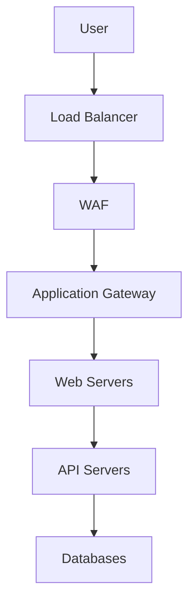
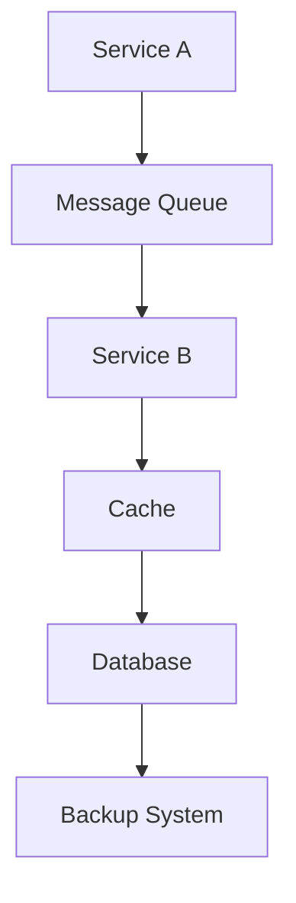

# Threat Modeling Framework

## Overview
This document outlines the comprehensive threat modeling approach for the GOV multi-cloud environment, providing a structured methodology for identifying, analyzing, and mitigating security threats.

## System Component Analysis

### Cloud Infrastructure Components
1. **AWS GovCloud**
   - EC2 instances
   - S3 buckets
   - RDS databases
   - Lambda functions
   - API Gateway
   - VPC configurations

2. **Azure Government**
   - Virtual Machines
   - Storage Accounts
   - Azure SQL
   - Functions
   - App Services
   - Virtual Networks

### Application Components
1. **Web Applications**
   - Frontend services
   - Backend APIs
   - Authentication services
   - Data processing services
   - Content delivery

2. **Data Storage**
   - Databases
   - Object storage
   - File systems
   - Backup systems
   - Archive storage

## Data Flow Analysis

### External Data Flows

### Internal Data Flows

## STRIDE Analysis

### Authentication Service
1. **Spoofing**
   - Threat: Identity impersonation
   - Controls:
     * Multi-factor authentication
     * Certificate-based authentication
     * PIV/CAC enforcement
     * Biometric validation

2. **Tampering**
   - Threat: Authentication data modification
   - Controls:
     * Digital signatures
     * Message integrity checks
     * Secure protocols
     * Audit logging

3. **Repudiation**
   - Threat: Action denial
   - Controls:
     * Secure audit trails
     * Digital signatures
     * Timestamp validation
     * Session logging

4. **Information Disclosure**
   - Threat: Credential exposure
   - Controls:
     * Encryption at rest
     * Encryption in transit
     * Access controls
     * Data masking

5. **Denial of Service**
   - Threat: Service availability impact
   - Controls:
     * Rate limiting
     * Load balancing
     * DDoS protection
     * Failover systems

6. **Elevation of Privilege**
   - Threat: Unauthorized access gain
   - Controls:
     * Least privilege
     * Role-based access
     * Privilege monitoring
     * Access reviews

### Data Storage Service
1. **Spoofing**
   - Threat: Storage access impersonation
   - Controls:
     * Strong authentication
     * Service authentication
     * Access key rotation
     * Identity validation

2. **Tampering**
   - Threat: Data corruption
   - Controls:
     * Checksums
     * Version control
     * Access logging
     * Integrity monitoring

3. **Repudiation**
   - Threat: Data modification denial
   - Controls:
     * Activity logging
     * Change tracking
     * User attribution
     * Audit trails

4. **Information Disclosure**
   - Threat: Data leakage
   - Controls:
     * Encryption
     * Access controls
     * Data classification
     * DLP solutions

5. **Denial of Service**
   - Threat: Storage availability
   - Controls:
     * Redundancy
     * Backup systems
     * Performance monitoring
     * Resource scaling

6. **Elevation of Privilege**
   - Threat: Unauthorized data access
   - Controls:
     * Access controls
     * Permission boundaries
     * Activity monitoring
     * Regular reviews

## Attack Surface Analysis

### Network Attack Surface
1. **External Endpoints**
   - Public APIs
   - Web applications
   - VPN endpoints
   - Load balancers
   - Content delivery

2. **Internal Services**
   - Service mesh
   - Internal APIs
   - Management interfaces
   - Monitoring systems
   - Administrative tools

### Application Attack Surface
1. **Input Vectors**
   - API parameters
   - File uploads
   - Form submissions
   - Authentication inputs
   - Configuration settings

2. **Output Vectors**
   - API responses
   - Error messages
   - Application logs
   - Status pages
   - Data exports

## Risk Assessment Matrix

### Impact Levels
1. **Critical**
   - System compromise
   - Data breach
   - Service disruption
   - Compliance violation
   - Reputation damage

2. **High**
   - Partial system access
   - Data exposure
   - Service degradation
   - Policy violation
   - Performance impact

3. **Medium**
   - Limited access
   - Minor data exposure
   - Feature disruption
   - Process deviation
   - Efficiency impact

4. **Low**
   - Minimal access
   - No data exposure
   - No service impact
   - Minor deviation
   - Limited effect

### Probability Levels
1. **High Likelihood**
   - Known exploits
   - Common attacks
   - Easy execution
   - Frequent occurrence
   - Limited controls

2. **Medium Likelihood**
   - Potential exploits
   - Targeted attacks
   - Complex execution
   - Occasional occurrence
   - Partial controls

3. **Low Likelihood**
   - Theoretical exploits
   - Sophisticated attacks
   - Difficult execution
   - Rare occurrence
   - Strong controls

## Mitigation Strategies

### Prevention Controls
1. **Technical Controls**
   - Security configurations
   - Access controls
   - Encryption
   - Network segmentation
   - Input validation

2. **Process Controls**
   - Security policies
   - Change management
   - Access reviews
   - Security training
   - Compliance checks

### Detection Controls
1. **Monitoring Systems**
   - SIEM integration
   - Log analysis
   - Threat detection
   - Anomaly detection
   - Performance monitoring

2. **Alert Mechanisms**
   - Real-time alerts
   - Threshold alerts
   - Correlation rules
   - Incident tickets
   - Escalation procedures

### Response Controls
1. **Incident Response**
   - Response procedures
   - Team activation
   - Communication plans
   - Recovery processes
   - Lesson learning

2. **Recovery Procedures**
   - System restoration
   - Data recovery
   - Service continuity
   - Control updates
   - Documentation updates

## Continuous Improvement

### Threat Intelligence
1. **External Sources**
   - Industry feeds
   - Government advisories
   - Vendor notifications
   - Security research
   - Threat reports

2. **Internal Analysis**
   - Security incidents
   - Attack patterns
   - Vulnerability trends
   - Control effectiveness
   - Risk evolution

### Model Updates
1. **Regular Reviews**
   - Threat assessment
   - Control validation
   - Risk evaluation
   - Process improvement
   - Documentation updates

2. **Change Triggers**
   - New threats
   - System changes
   - Control updates
   - Incident lessons
   - Compliance requirements

## References
1. NIST SP 800-154
2. OWASP Threat Modeling
3. MITRE ATT&CK Framework
4. Cloud Security Alliance
5. DoD Threat Modeling Guide
